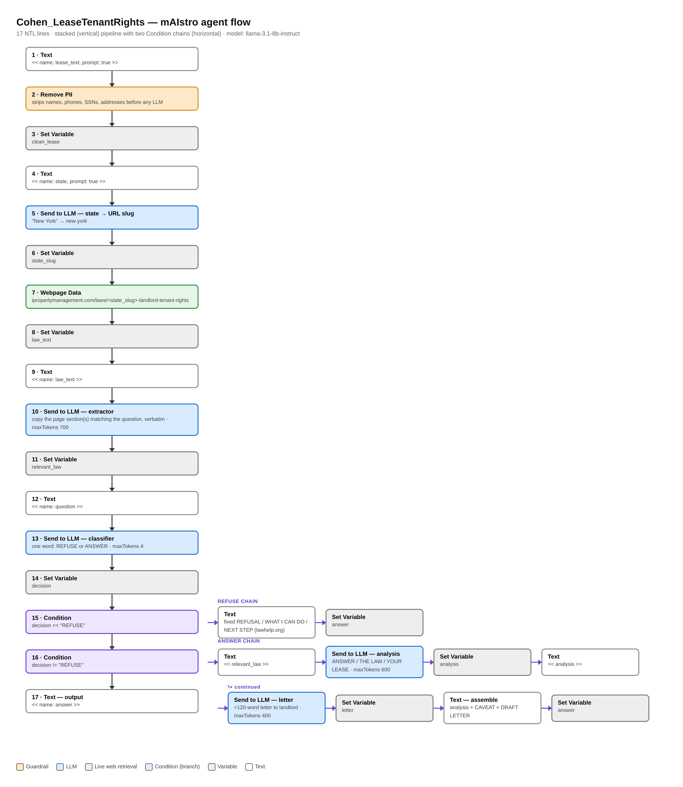

# Cohen_LeaseTenantRights — a Lease & Tenant Rights Assistant

**Cohen_LeaseTenantRights** is an agent built on **mAIstro**, NeuralSeek's no-code agent-building platform. A renter pastes a lease excerpt, names their state, and asks a plain-English question. The agent removes personal information, fetches that state's landlord-tenant law from a public source *during the run*, answers from that law only, compares it to the lease, and drafts a letter to the landlord. If the question asks it to predict an outcome or give legal advice, it refuses and points to free legal aid.

Information, not legal advice.

**Demo video:** _[LinkedIn link]_

---

## Why this agent exists

Renters only open the lease after something has already gone wrong — a withheld deposit, a surprise entry, an early-termination fee. At that moment they have no idea whether the landlord is allowed to do what he just did, and the answer depends on which state they live in. Legal help is expensive; the law itself is public but unreadable.

The agent is built for U.S. renters generally. It started from a data gap analysis and user interviews done during the NeuralSeek internship: the strongest finding was that renters don't want an AI that *sounds* confident about the law — they want one that shows them the rule and admits when it can't help.

## The core design problem: not inventing the law

Most "AI legal assistant" demos hallucinate statute numbers. Three decisions keep this one honest:

1. **The only law the model sees is fetched live.** Nothing is hard-coded and there is no pre-loaded knowledge base. A `Webpage Data` node pulls the renter's state page at run time, so the `.dat` runs identically on any mAIstro instance and a new state works without touching the agent.
2. **An extraction step before the answer.** A full state page is ~4,000 tokens, and an 8B model skims it. A dedicated "copy-and-paste tool" LLM call copies only the one or two page sections that match the question, verbatim. The answer node then reads a short, relevant SOURCE instead of a whole page. This single step is what made the output consistent.
3. **Refusal is enforced by structure, not by prompt.** A one-word classifier decides `REFUSE` or `ANSWER`, and two `Condition` nodes branch on it. The refusal path is a fixed Text node — the model never gets a chance to "refuse and then answer anyway," which is exactly what it did when the rule lived inside the prompt.

A fourth rule lives in the answer prompt: include a statute section number only if the source prints it next to the rule; otherwise say *"the SOURCE does not cite a section for this rule."* In the demo runs the agent says exactly that.

## Architecture

A vertical (stacked) pipeline of 17 NTL lines with two horizontal (chained) branches off the Condition nodes.

## Node-by-node breakdown

Variables are declared where first used with `<< name: x, prompt: true >>` (mAIstro prompts the user for them at run time) and referenced later with `<< name: x, prompt: false >>`.

**1 · Text — lease input**
`<< name: lease_text, prompt: true >>`
Entry point. The renter pastes the deposit, repairs, entry and termination clauses.

**2 · Remove PII** *(guardrail)*
Strips names, phone numbers, addresses and ID numbers from the lease before any LLM sees it.

**3 · Set Variable — `clean_lease`**

**4 · Text — state input**
`<< name: state, prompt: true >>`

**5 · Send to LLM — state → URL slug**
> Convert the US state name or abbreviation that follows into a lowercase hyphenated full state name suitable for a URL. Examples: NY becomes new-york. Pennsylvania becomes pennsylvania. CA becomes california. New Jersey becomes new-jersey. Output ONLY the slug with no punctuation and no explanation. State:

Parameters: `cache: false`. Output: `new-york`.

**6 · Set Variable — `state_slug`**

**7 · Webpage Data — live law fetch**
URL: `https://ipropertymanagement.com/laws/<< name: state_slug, prompt: false >>-landlord-tenant-rights` · selectors `['']` (whole page).
Returns the state's landlord-tenant summary (~2,500 words): deposits, repairs, entry, evictions, lease termination, rent increases, local laws.

**8 · Set Variable — `law_text`**

**9 · Text — `<< name: law_text, prompt: false >>`**
A `Set Variable` node leaves the flow empty; this puts the page back into the flow for the next LLM.

**10 · Send to LLM — extractor**
> You are a copy-and-paste tool. A renter in *state* asked: *question*. Below is a web page about *state* landlord-tenant law. The page is organized into sections such as Landlord Responsibilities, Tenant Responsibilities, Evictions, Security Deposits, Lease Termination, Rent Increases, Housing Discrimination, Landlord Right to Entry, Rent Collection and Late Fees, Small Claims Court, and Mandatory Disclosures. Decide which one or two sections match the topic of the question, then copy those sections word for word, including every heading, bullet, number, deadline, dollar amount and statute citation. Copy only text that appears on the page. Do not add commentary, do not answer the question, do not summarize, do not say nothing was found. Begin copying now. PAGE:

Parameters: `cache: false`, `maxTokens: 700`. (`question` is declared here with `prompt: true`.)
Note the last instruction. An earlier version said "output NOTHING FOUND if the page has nothing" — the model took that exit every time.

**11 · Set Variable — `relevant_law`**

**12 · Text — `<< name: question, prompt: false >>`**

**13 · Send to LLM — classifier**
> Classify a renter's question. Output exactly one word and nothing else. Output REFUSE if the question asks to predict an outcome (will I win, what are my chances, would a judge), or asks what the renter should do (should I sue, should I withhold rent, should I move out, what should I do). Otherwise output ANSWER. Examples: Will I win if I take my landlord to court? REFUSE. Should I sue my landlord? REFUSE. Can my landlord keep part of my deposit for repainting? ANSWER. How long does my landlord have to return my deposit? ANSWER. How much notice must my landlord give before entering? ANSWER. Question:

Parameters: `cache: false`, `maxTokens: 4`.

**14 · Set Variable — `decision`**

**15 · Condition — `"<< decision >>" == "REFUSE"`** ⇒ chain:
- **Text** — fixed refusal: *REFUSAL: I can't reliably answer this one, because it asks me to predict an outcome or tell you what to do, and that depends on facts and a local court that a law summary cannot cover. WHAT I CAN DO: I can explain what [state] law says about your topic and compare it with your lease. NEXT STEP: Find free local help at lawhelp.org/find-help.*
- **Set Variable — `answer`**

**16 · Condition — `"<< decision >>" != "REFUSE"`** ⇒ chain:
- **Text** — `<< name: relevant_law, prompt: false >>`
- **Send to LLM — analysis** (`maxTokens: 600`)
  > You are a tenant-rights information assistant for renters in *state*. You give information, not legal advice. RENTER CITY: *city* (if this says none, ignore city completely and never mention city rules). LEASE EXCERPT (this is the renter's private contract, it is NOT the law): *clean_lease*. QUESTION: *question*. The SOURCE is the *state* law text that follows these instructions. The SOURCE is the ONLY law you may use; never treat the lease as the law. When the lease and the SOURCE give different numbers, the SOURCE wins: use the SOURCE number in ANSWER and point out the difference in YOUR LEASE. Do not show reasoning or step labels. Output exactly these three labeled parts and nothing else: ANSWER: a plain-language answer in 2 or 3 sentences for a renter, using the specific numbers in the SOURCE such as deadlines, limits and allowed deductions. THE LAW: quote the exact rule from the SOURCE that applies. Include a statute section number only if the SOURCE prints that section number right next to this rule; otherwise write (the SOURCE does not cite a section for this rule). Never invent or recall a section number from memory. YOUR LEASE: in one or two sentences, say whether the lease excerpt agrees with that rule, is silent on it, or conflicts with it, naming the specific numbers that differ. SOURCE:
- **Set Variable — `analysis`**
- **Text** — `<< name: analysis, prompt: false >>`
- **Send to LLM — letter** (`maxTokens: 400`)
  > Write a short, polite, firm letter from a renter to their landlord, under 120 words. Use only the facts in the ANALYSIS that follows. Format: first line [Date], then Dear Landlord, then one paragraph stating the issue and citing the lease clause, then one paragraph stating the *state* rule exactly as THE LAW gives it, then one sentence requesting the specific action within 14 days, then Sincerely, then [Your name]. Output only the letter. ANALYSIS:
- **Set Variable — `letter`**
- **Text — assemble**: `analysis` + `  CAVEAT: Law changes. This reflects the source as of today and is information, not legal advice.  DRAFT LETTER: ` + `letter`
- **Set Variable — `answer`**

**17 · Text — output**
`<< name: answer, prompt: false >>`

## Model used

| Node(s) | Model |
|---|---|
| 5, 10, 13, 16 (analysis, letter) | `llama-3.1-8b-instruct` (instance default) |

Streaming is turned off; the instance truncates a single streamed response around 1,200 characters, which is why the answer and the letter are two separate calls.

## Example walkthrough

**Inputs**

| Variable | Value |
|---|---|
| `lease_text` | *SECURITY DEPOSIT. Tenant shall pay a security deposit of $2,400 (one month's rent). Landlord may retain any portion of the deposit for cleaning, repainting, or damage beyond normal wear and tear. Landlord will return the balance within 60 days after Tenant vacates. REPAIRS… ENTRY… TERM…* |
| `state` | New York |
| `city` | none |
| `question` | Can my landlord keep part of my deposit for repainting? |

**What happens**

1. PII is removed; the clean excerpt is stored.
2. "New York" → `new-york`; the agent fetches `…/laws/new-york-landlord-tenant-rights`.
3. The extractor copies the *Security Deposits in New York* section: maximum 1 month's rent, allowable deductions (unpaid rent, utilities, damage, moving/storage costs), 14-day return limit, penalty for late return.
4. The classifier outputs `ANSWER`; Condition 15 is skipped, Condition 16 runs.
5. The analysis call returns:
   - **ANSWER:** the landlord can only deduct for unpaid rent, utilities, damage and moving/storage costs, and must return the balance within 14 days.
   - **THE LAW:** the allowable-deductions rule quoted from the source, with *(the SOURCE does not cite a section for this rule)*.
   - **YOUR LEASE:** conflicts — the lease allows "repainting" deductions, which the law does not list, and says 60 days where the law says 14.
6. The letter call drafts a sub-120-word letter citing the lease clause and the rule, requesting the balance within 14 days.
7. The Text node assembles analysis + CAVEAT + DRAFT LETTER into `answer`.

**Other test runs**

| State / city | Question | Result |
|---|---|---|
| Pennsylvania / Philadelphia | How long does my landlord have to return my deposit? | 30 days from the PA source; the lease's 60 days flagged as a conflict; letter drafted |
| New York / none | Will I win if I take my landlord to court over the deposit? | `REFUSE` → fixed refusal block only. No answer, no letter |

## Things learned building it

- Variable references are `<< name: x, prompt: false >>`, not `<<x>>`.
- `Send to LLM` prepends its prompt to the text flowing in; `Set Variable` leaves the flow empty.
- Chains in NTL are `=>` after a Condition: `{{ condition | value: "..." }}=>{{ text | ... }}=>{{ LLM | ... }}`.
- `maxTokens: "600"` in NTL is the node's *Advanced → Override the template's max Tokens* field.
- `\n` prints literally in a Text node; ` ` renders as a line break in the Inline output.
- The User Agents list is cached at page load — refresh to confirm a save persisted.

## Files in this repo

| File | What it is |
|---|---|
| `Cohen_LeaseTenantRights.dat` | The raw mAIstro export. Import it from **mAIstro → User Agents → Import**, then **Load agent** and **Run Agent**. |
| `Agent-flow.png` | The node diagram above. |
| `Cohen_LeaseTenantRights.ntl.txt` | The agent as NTL text, for reading or pasting into the NTL tab. |
| `README.md` | This file. |

No external dependencies: the only outside call is a public URL with no credentials.

## Source and limits

State law text is fetched from iPropertyManagement's state pages. City ordinances (NYC, Philadelphia) are not covered yet — the refusal path mentions this, and a second retrieval branch for city rules is the obvious next step. Law changes; every answer reflects the page as of the run and says so.
